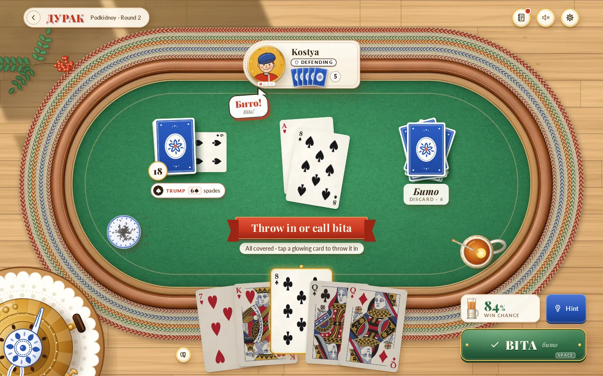
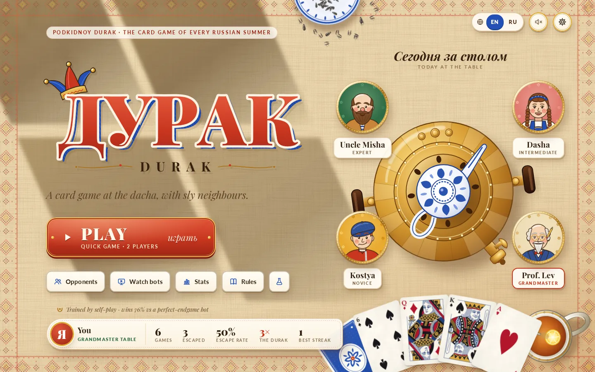
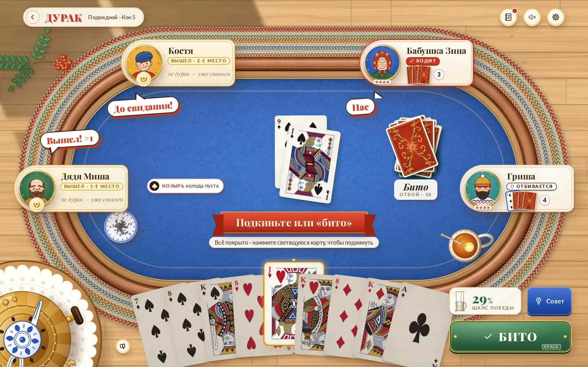
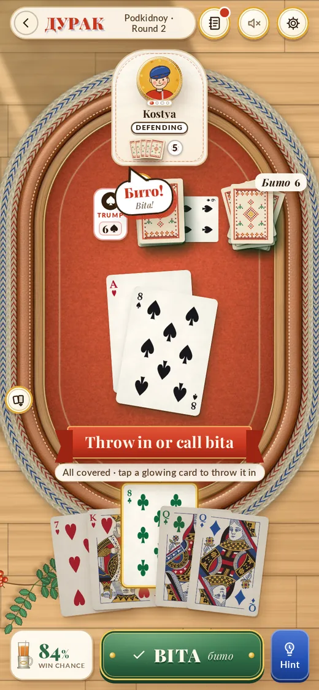

# DurakBot

**Podkidnoy Durak for 2–6 players, with computer opponents from beginner to a self-play reinforcement-learning champion, and an illustrated web table to play them on.**



DurakBot is a complete implementation of Podkidnoy Durak, the Russian card game in which nobody wins and one player is left as the *durak* (the fool). It contains a fast rules engine for 2–6 players, a card-counting heuristic bot, an exact endgame solver with a C core, an Elo-style rating ladder with four calibrated difficulty levels, and a champion trained from scratch by PPO self-play on a single CPU machine. The web app seats you at a sunlit dacha table with an illustrated cast of opponents, gives move hints and win chances, and replays and analyses your games afterwards. Every bot plays only from the information a human in its seat would have.

**Play online: <https://thverg.github.io/DurakBot/>**. The online version runs entirely in the browser, with no game server; see [docs/STATIC_BUILD.md](docs/STATIC_BUILD.md).

| Title screen | Five players (Russian UI) | Phone |
|---|---|---|
|  |  |  |

More screenshots (replay and analysis, the Lab dashboard) are in [docs/WEBAPP.md](docs/WEBAPP.md).

## Features

- **Rules engine** (`durak/engine.py`): Podkidnoy Durak with a 36-card deck for 2–6 players, neighbours-only throw-in, a five-card limit in the first bout and a stall rule that ends endless multiplayer cycles as a draw. Cards and hands are integer bitmasks, so the engine is fast and cheap to clone, and it can resample hidden cards consistently with what one player knows ("determinization").
- **Bots**: `random`, a card-counting `heuristic`, `solver` (heuristic plus perfect endgames), the RL `champion` (policy network, exact endgame solver and Monte Carlo search) and `champion_fast` (no search), plus four difficulty levels for people: `novice`, `intermediate`, `expert` and `grandmaster`.
- **Exact endgame solver** (`durak/solver.py`, `durak/_solver.c`): alpha-beta with a transposition table, exact dominance pruning and killer moves. It plays two-player endgames perfectly once the talon is empty, which is how every game ends, whatever the number of players.
- **Reinforcement learning** (`durak/rl/`): one network for all player counts, trained with asynchronous PPO self-play against a prioritized league of past snapshots and the heuristic bot. It has a belief head that predicts where the unseen cards are, belief-weighted PIMC search at play time, and a two-stage statistical gate that decides when a new network becomes the champion.
- **Evaluation**: an arena with seat rotation over identical deals, paired comparisons with deal-clustered confidence intervals, and a Luce/Elo ladder per player count.
- **Web app** (`server/`, `web/`): a FastAPI server and a React front end with drag-and-drop or keyboard play, animated card flights, a tutorial, hints with win percentages, replay and post-game analysis, spectator mode, game statistics, a Lab dashboard for training and evaluation, English and Russian, and layouts for desktop and phone.
- **Art pipeline**: procedural card backs and table art, card faces built from a public-domain (CC0) deck, illustrated portraits and an art kit with design tokens, all reproducible from scripts.

## The rules in brief

Podkidnoy ("throw-in") Durak is played with 36 cards (6 to Ace in four suits). Each player gets six cards; the bottom card of the talon is turned face up and sets the trump suit.

- The attacker leads a card to the next player clockwise, the defender, who must beat it with a higher card of the same suit or with any trump (a trump only by a higher trump), or give up.
- Once the table is covered, more cards whose rank is already on the table can be added, but only by the attacker and the defender's *other* neighbour. A bout holds at most six attack cards (five in the very first bout of the game), and never more than the defender held when the bout began.
- If the defender beats everything, the cards are discarded (*bita*) and the defender attacks next. If the defender gives up, the attackers may throw in more matching cards, and then the defender picks up everything and loses the next turn to attack.
- Everyone draws back up to six cards, the attacker first and the defender last. Once the talon is empty, players who run out of cards are out. The last player holding cards is the durak; if the last players run out together, the game is a draw.

The full rules as implemented, with worked examples, are in [docs/RULES.md](docs/RULES.md).

## Results

### Champion strength

*Champion: network iteration 197,800, promoted on 2026-10-19. Source: `runs/eval_summary.json` (updated 2026-10-19), a running estimate over the six gate evaluations since that promotion.*

The table shows how often one champion seat ended up as the durak against a field of the given opponent. Each deal is played once from every seat, so luck of the deal cancels out. Lower is better, and the fair share is 1/N. The champion here uses its policy network and the exact endgame solver, without search; the deployed `champion` and `grandmaster` add search on top.

| Opponents in the other seats | 2 players | 3 players | 4 players | 5 players | 6 players |
|---|---|---|---|---|---|
| *Fair share (1/N)* | *50.0%* | *33.3%* | *25.0%* | *20.0%* | *16.7%* |
| `heuristic` bot | **15.1%** | **9.8%** | **8.5%** | **7.2%** | **6.1%** |
| `heuristic` with perfect endgames (≈ `solver` bot) | **23.9%** | **14.5%** | **12.9%** | **10.8%** | **8.4%** |
| Frozen network from iteration 1,500 | 33.9% | 22.4% | 18.0% | 14.5% | 12.5% |
| Frozen network from iteration 100,000 | 45.0% | 30.0% | 23.2% | 19.0% | 16.0% |
| `random` | 0.0% | 0.0% | 0.0% | 0.0% | 0.0% |

The heuristic and solver rows are 9,600 games per cell (95% intervals about ±0.5 to ±0.9 points), the frozen networks 2,400 and `random` 200. In two-player terms the champion avoids being the durak in 84.9% of games against the heuristic bot and in 76.1% against an opponent that plays every endgame perfectly. [docs/EVALUATION.md](docs/EVALUATION.md) explains the protocol and how to read these numbers.

### Rating ladder and difficulty levels

*Source: `runs/ladder.json`, fitted on 2026-10-14 from 37,544 games. The champion rated here is the network that was champion on that day (around iteration 2,400 of the main run); the ladder has not yet been refitted for the current champion.*

Ratings are Elo-like and anchored at `random` = 0, separately for each player count. With two players this is ordinary Elo; with more players, each seat's chance of being the durak is proportional to 10^(−rating/400) (the Luce model in [docs/EVALUATION.md](docs/EVALUATION.md#the-rating-ladder)).

| Agent | 2p | 3p | 4p | 5p | 6p |
|---|---|---|---|---|---|
| `champion` (= `grandmaster`) | 984 | 872 | 863 | 790 | 689 |
| `champion_fast` | 950 | 881 | 804 | 735 | 650 |
| `solver` | 834 | 787 | 731 | 663 | 606 |
| `heuristic` | 759 | 733 | 668 | 624 | 566 |
| `expert` | 690 | 716 | 663 | 651 | 576 |
| `intermediate` | 547 | 529 | 456 | 453 | 380 |
| `novice` | 316 | 259 | 225 | 241 | 216 |
| `random` | 0 | 0 | 0 | 0 | 0 |

The champion's 95% intervals are about ±70 to ±90 points; those of the other agents are mostly narrower. The blunder rates of the four difficulty levels were tuned on this ladder, aiming for gaps of about 200 points (about 150 with six players, where luck compresses the scale).

These result files are produced locally by training and evaluation and are not part of the repository; the numbers above are a snapshot.

## Quick start

Requirements: Linux (the project is developed on Ubuntu 24.04), Python 3.12, `gcc` for the native solver, and Node.js 18 or newer with npm for the web front end. Nothing needs a GPU.

```bash
git clone https://github.com/ThVerg/DurakBot.git
cd DurakBot

# Python environment (uv; plain venv + pip works the same way)
uv venv .venv --python 3.12
uv pip install --python .venv/bin/python -r requirements.txt \
    --extra-index-url https://download.pytorch.org/whl/cpu --index-strategy unsafe-best-match
# optional: browser e2e tests, ONNX export, art pipeline
uv pip install --python .venv/bin/python -r requirements-dev.txt \
    --extra-index-url https://download.pytorch.org/whl/cpu --index-strategy unsafe-best-match

# Run the test suite (a few minutes; the browser tests are skipped without Playwright)
.venv/bin/python -m pytest -q
```

### Play locally

```bash
scripts/serve.sh            # builds web/ if needed, then serves on http://localhost:8000
```

Open <http://localhost:8000>, choose the number of players and the opponents, and play. The trained champion ships in the repository as `checkpoints/champion.pt`. `HOST` and `PORT` override the address, and `SKIP_BUILD=1` skips the front-end build. For front-end development, run the API with `.venv/bin/python -m uvicorn server.app:app --reload --port 8000` and the Vite dev server with `cd web && npm install && npm run dev` (it proxies `/api` to port 8000).

### Bots on the command line

```bash
.venv/bin/python -m durak.arena heuristic random --players 2 --games 1000
.venv/bin/python -m durak.arena champion_fast heuristic --players 4 --games 400 --workers 4
```

Each command plays agent A in one seat against a field of agent B, rotating A through every seat of every deal, and prints A's durak rate with a 95% interval. See [docs/BOTS.md](docs/BOTS.md) for the agents and how to write your own.

### Train

```bash
scripts/train.sh                        # start or resume the run "main" in the background
scripts/status.sh                       # progress, evaluations, league, current champion
.venv/bin/tensorboard --logdir runs/main/tb
NAME=main scripts/train.sh --stop       # stop gracefully; running train.sh again resumes
```

The defaults (7 rollout processes and a 4-thread learner) are sized for a 16-thread desktop CPU. Use `WORKERS=3 LTHREADS=2 scripts/train.sh --eval-workers 1` on smaller machines, and `--no-gate` for experiments that must never replace `checkpoints/champion.pt`. [docs/TRAINING.md](docs/TRAINING.md) covers the method, monitoring, resuming and evaluation.

## Project layout

```text
DurakBot/
├── durak/                 rules engine, bots, solver, arena, ladder
│   ├── cards.py           card encoding and bitmask helpers
│   ├── engine.py          DurakGame: rules, legal moves, determinization
│   ├── solver.py          exact endgame solver (Python reference + native binding)
│   ├── _solver.c          native solver core, compiled automatically on first use
│   ├── arena.py           agent-vs-field matches over rotated deals
│   ├── ladder.py          Luce/Elo rating ladder per player count
│   ├── testing.py         position builders and invariant checks
│   ├── agents/            random, heuristic, solver, champion, difficulty levels
│   └── rl/                encoding, model, rollout, train, gate, evaluate, search, tournament
├── server/                FastAPI server: sessions, hints and analysis, Lab data, SQLite stats
├── web/                   React + Vite web app
│   ├── src/               app shell, Dacha table, lobby, sheets, replay, Lab, i18n
│   ├── public/assets/     card faces, backs, Dacha art kit, fonts (see LICENSES.md)
│   └── tools/art/         card, back, avatar and material pipeline
├── concepts/              four static design concepts and the Dacha kit tools
├── checkpoints/           champion.pt (other checkpoints stay local)
├── scripts/               serve.sh, train.sh, status.sh, static-build tools
├── tests/                 pytest suite, including Playwright browser tests
└── docs/                  documentation
```

Training runs write to `runs/`, which, like most of `checkpoints/`, is not tracked.

## Documentation

| Guide | Contents |
|---|---|
| [RULES.md](docs/RULES.md) | The complete rules as implemented, with examples |
| [ARCHITECTURE.md](docs/ARCHITECTURE.md) | Components, data flow and the information-hiding boundaries |
| [ENGINE.md](docs/ENGINE.md) | Card and action encoding, the `DurakGame` API, test helpers |
| [BOTS.md](docs/BOTS.md) | The agent interface, every bot, difficulty levels, no-cheating guarantees |
| [SOLVER.md](docs/SOLVER.md) | The exact endgame solver: search, pruning, C core, budgets |
| [TRAINING.md](docs/TRAINING.md) | Observation, model, PPO, league, belief head, search, gating, running training |
| [EVALUATION.md](docs/EVALUATION.md) | Arena, paired evaluation, gate, tournament, ladder, reading the numbers |
| [WEBAPP.md](docs/WEBAPP.md) | Web app features, HTTP API, front-end structure, design system, tests |
| [STATIC_BUILD.md](docs/STATIC_BUILD.md) | Running entirely in the browser and deploying to GitHub Pages |
| [ART.md](docs/ART.md) | Asset inventory, pipelines, rebuilding, licences |
| [DEVELOPMENT.md](docs/DEVELOPMENT.md) | Environment, tests, scripts, code style |

The research log of the training rounds, with A/B experiments and throughput measurements, is in [durak/rl/README.md](durak/rl/README.md). Contributions are welcome; see [CONTRIBUTING.md](CONTRIBUTING.md).

## Licence

DurakBot is released under the [MIT licence](LICENSE), copyright (c) 2026 ThVerg.

Third-party assets keep their own licences ([THIRD_PARTY_NOTICES.md](THIRD_PARTY_NOTICES.md)); [web/public/assets/LICENSES.md](web/public/assets/LICENSES.md) and [docs/ART.md](docs/ART.md) list them in full:

- **Card faces**: derived from the *English pattern* SVG playing cards by **Dmitry Fomin** ([Wikimedia Commons](https://commons.wikimedia.org/wiki/User:Dmitry_Fomin)), dedicated to the public domain under [CC0 1.0](https://creativecommons.org/publicdomain/zero/1.0/). Attribution is not required and is given with thanks.
- **Fonts**: [Playfair Display](https://github.com/clauseggers/Playfair-Display) (The Playfair Display Project Authors) and Lato (Łukasz Dziedzic) are bundled with the web app under the [SIL Open Font License 1.1](https://openfontlicense.org/); the licence texts are in `web/public/assets/dacha/fonts/`. The design concepts also bundle Nunito and Inter (OFL 1.1). EB Garamond (OFL 1.1) appears only as glyph outlines in the logo artwork, and URW P052 (AGPL-3.0 with the font exception) only as rasterised card indices; no files of these two fonts are distributed.

## Acknowledgements

Thanks to Dmitry Fomin for the public-domain card designs, to the authors of Playfair Display, Lato, EB Garamond, Nunito and Inter, and to the projects DurakBot is built on: PyTorch, NumPy, FastAPI, Uvicorn, React, Vite, onnxruntime and Playwright.
