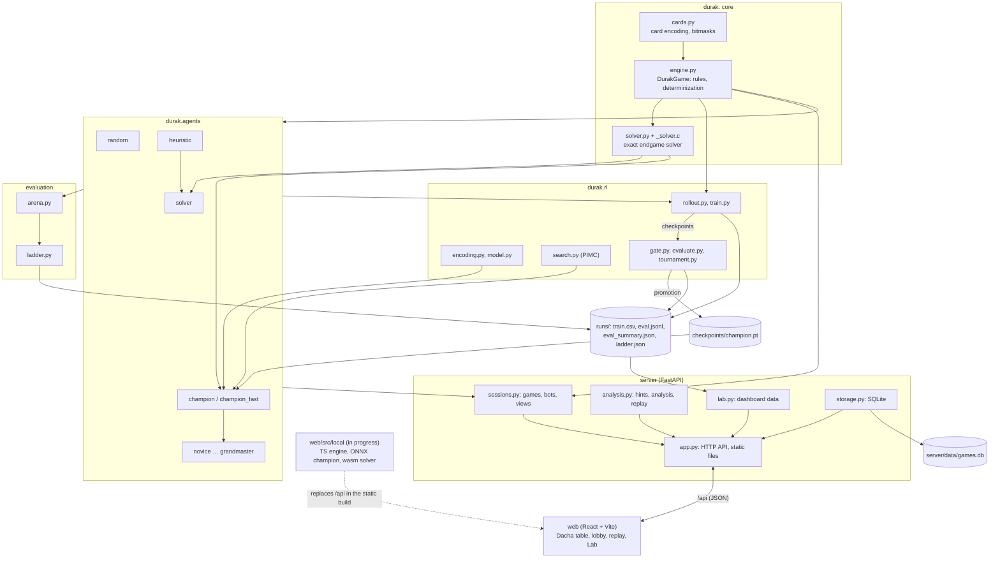
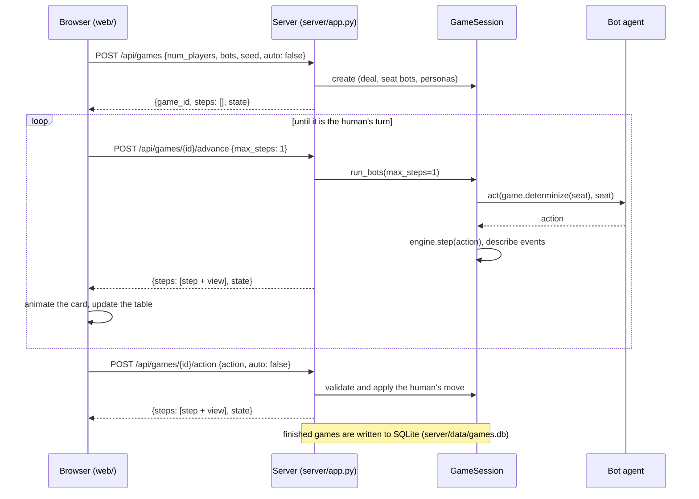
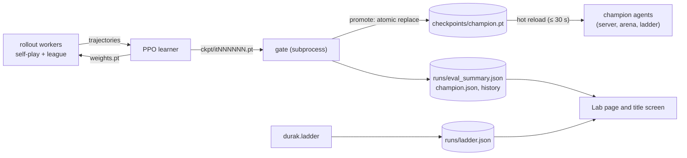

# Architecture

DurakBot is a Python package (`durak`) with a web server (`server`) and a browser client (`web`) on top. This page shows how the parts fit together, how data flows between them, and where the boundaries are that keep hidden cards hidden.

## Components

| Layer | Responsibility | Depends on |
|---|---|---|
| `durak/cards.py`, `durak/engine.py` | the rules, and nothing else | standard library only |
| `durak/solver.py`, `durak/_solver.c` | exact two-player endgames | engine; a C compiler (optional) |
| `durak/agents/` | every computer player behind one interface | engine, solver; PyTorch for the champion |
| `durak/rl/` | observation encoding, network, self-play training, gating, search | engine, agents, solver, PyTorch, NumPy |
| `durak/arena.py`, `durak/ladder.py` | strength measurement | engine, agents; NumPy for the ladder fit |
| `server/` | game sessions over HTTP, coach features, statistics, dashboard data | engine, agents, FastAPI |
| `web/` | user interface | the HTTP API |

The detailed guides are [ENGINE.md](ENGINE.md), [BOTS.md](BOTS.md), [SOLVER.md](SOLVER.md), [TRAINING.md](TRAINING.md), [EVALUATION.md](EVALUATION.md) and [WEBAPP.md](WEBAPP.md).

## Design principles

- **One source of truth for the rules.** Only `durak/engine.py` decides what is legal and what happens. The server calls `legal_actions()` and `step()` and describes what happened by comparing the public state before and after; the browser never applies rules itself. The solver, the RL tracker and the TypeScript port re-implement parts of the rules for speed and are tested against the engine.
- **Bitmasks everywhere.** Hands and card sets are integers, so cloning a game, comparing positions and encoding observations are cheap, which matters for search and for self-play at billions of decisions.
- **Information hiding at the boundary.** Bots receive determinized copies, and clients receive filtered views (next section).
- **Reproducibility.** Deals come from seeds; the arena, the evaluator and the gate reseed every game, so a measurement can be repeated exactly and two agents can be compared on identical deals.
- **Graceful degradation.** The native solver falls back to Python; a bot that cannot load (for example without a checkpoint) is reported as unavailable; every Lab data source is optional; missing art falls back to simpler assets.

## Information-hiding boundaries

Hidden information is protected at three points:

1. **Between the game and a bot.** The arena (`durak/arena.py`), the server (`server/sessions.py`) and the evaluation tools never pass the real `DurakGame` to an agent. They pass `game.determinize(player, rng)`, a copy in which every card hidden from that player has been redealt at random. See [BOTS.md](BOTS.md#no-cheating-guarantees).
2. **Between the server and the browser.** `GameSession.view()` builds the state that is sent to the client. Opponents' hands are included only in spectator mode or when the player has turned on the debug reveal; otherwise the client receives hand sizes and publicly known cards only. In a game with a human player, drawn cards are reported only for the human's own seat, and the stored move history never contains the bots' drawn cards, even while the debug reveal is on. Replays show positions as the human saw them.
3. **Between the coach and the game.** Hints, win chances and the post-game analysis are computed on determinizations of the human's information set, so they cannot reveal where the hidden cards really are.

Tests cover each boundary, including browser tests that check that hidden cards never reach the page's DOM.

## Data flow: playing a game

The server holds every game in memory and is the authority; the browser animates what the server reports. Bot moves are streamed one at a time so that each can be animated as soon as it is made:

Each request runs in a worker thread under a per-session lock, so slow bots never block other games. Sessions are kept in memory, at most 500 of them, and the least recently used are dropped first. With `auto: true` (the default) the server plays all bot moves up to the human's next turn in a single response instead. Details of every endpoint are in [WEBAPP.md](WEBAPP.md#http-api).

## Data flow: training and deployment

The trainer and the web server can run at the same time on the same machine. When the gate promotes a new network it replaces `checkpoints/champion.pt` atomically, and every `champion` agent in a running process notices the change within 30 seconds and loads the new weights; a failed load keeps the previous network. The Lab page reads the training and evaluation files directly from disk, caching each by modification time. See [TRAINING.md](TRAINING.md).

## Data files

| File | Written by | Read by | In the repository |
|---|---|---|---|
| `checkpoints/champion.pt` | `durak.rl.gate` on promotion | the champion agent and the levels | yes |
| `checkpoints/champion.json`, `champion_history.jsonl`, `champion_stats.json` | `durak.rl.gate` | `scripts/status.sh`, Lab | no |
| `checkpoints/frozen_it*.pt` | copied by hand | `durak.rl.gate` (reference networks) | no |
| `runs/<name>/…` | `durak.rl.train`, `durak.rl.gate` | `scripts/status.sh`, Lab, TensorBoard | no |
| `runs/eval_summary.json` | `durak.rl.gate` | Lab, title screen | no |
| `runs/ladder_games.jsonl`, `runs/ladder.json` | `durak.ladder` | Lab, bot ratings in the lobby | no |
| `server/data/games.db` | the server | `/api/stats`, Lab | no |
| `web/dist/` | `npm run build` | the server | no |

A fresh clone therefore has a fully playable champion, while the dashboards start empty until training, evaluation or games produce their files.

## The static build

For GitHub Pages the web app is being extended to run without the server: a TypeScript port of the engine, the champion network exported to ONNX and run with onnxruntime-web, and the solver's C core compiled to WebAssembly, all under `web/src/local/` and `web/public/ai/`. The front end will talk to this local backend instead of `/api`. See [STATIC_BUILD.md](STATIC_BUILD.md).
