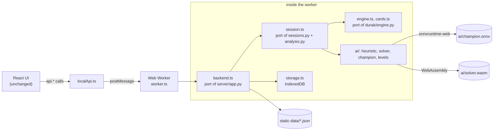

# Running in the browser (static build)

**Play online: <https://thverg.github.io/DurakBot/>**

> **Status: in progress.** The in-browser build is being completed. The overall design below is settled, but file names, commands, sizes and the remaining differences from the server version are **to be finalised** and may change before release.

The regular web app needs the Python server: the server deals the cards, runs the bots and stores the statistics ([WEBAPP.md](WEBAPP.md)). The static build removes that dependency. The same React interface runs together with a complete game backend in the browser, so the site can be hosted as plain files on GitHub Pages, and nothing is sent to a server.

## How it works



- **One switch.** Building with `VITE_BACKEND=local` replaces the HTTP client in `web/src/api.ts` with `web/src/local/localApi.ts`, which has the same functions and returns the same JSON as the [HTTP API](WEBAPP.md#http-api). The rest of the interface does not know the difference. A normal build replaces the local backend with a stub, so none of it is bundled.
- **Off the main thread.** Every call is forwarded to a Web Worker that hosts the backend, so the bots' thinking never blocks animations.
- **Faithful ports.** The engine (`web/src/local/engine.ts`, `cards.ts`, `rng.ts`), the sessions and coach features (`session.ts`), statistics (`storage.ts`) and the bots (`web/src/local/ai/`: the heuristic, the observation encoder, the champion with its search, the difficulty levels and the solver wrapper) are line-by-line ports of the Python code. Card sets stay 36-bit integers, held in JavaScript numbers and manipulated with helper functions; [`web/src/local/ENGINE_API.md`](../web/src/local/ENGINE_API.md) maps the Python API to the TypeScript one.
- **The champion network** is exported to ONNX (`web/public/ai/champion.onnx`, about 5.7 MB, plus `champion.json` with its version and checksums) and runs with onnxruntime-web on its WebAssembly backend, single-threaded, because GitHub Pages cannot send the headers needed for shared memory.
- **The endgame solver** is the unmodified `durak/_solver.c`, compiled to WebAssembly (`web/public/ai/solver.wasm`, about 12 KB) with a small shim for memory allocation and the clock. Its transposition table defaults to 2^19 entries (24 MiB) in the browser.
- **Persistence.** Finished games and resumable sessions are stored in the browser's IndexedDB (in memory when IndexedDB is unavailable), so statistics stay on the player's device.
- **Static data.** What the server computes from local files is exported once into `web/public/static-data/`: bot metadata and ratings (`bots.json`), the Lab dashboard (`lab.json`), the evaluation summary, the ladder, and the list of high-resolution art (`art-hires.json`).
- **Sub-path hosting.** `VITE_BASE=/DurakBot/` makes every URL relative to the GitHub Pages path; the app's own routes use the URL hash (`#/lab`), so no server-side routing is needed.

The no-cheating guarantees carry over unchanged: bots receive determinized copies, views hide the bots' hands, and hints and analysis use only the player's information.

## Differences from the server version

*To be finalised.* Expected differences:

- The Lab shows the training and evaluation data exported at build time, not live data, and the "your results" part comes from the games played in that browser.
- Statistics and the "continue game" feature are per browser and device.
- The search budget is scaled for a single-threaded worker, and the first move of a session waits for the network and solver to download.

## Building it

*Provisional commands; to be finalised.*

```bash
# 1. Export the data the static site serves (run after training or ladder updates)
.venv/bin/python scripts/export_static_data.py

# 2. Export the champion to ONNX and run the parity checks
#    (also rebuilds solver.wasm when durak/_solver.c has changed)
scripts/refresh_browser_model.sh

# 3. Build and preview the static site
cd web
npm ci
npm run build:static     # VITE_BACKEND=local VITE_BASE=/DurakBot/, output in web/dist-static
npm run preview:static   # http://localhost:4173/DurakBot/
```

| Script | Purpose |
|---|---|
| `scripts/export_static_data.py` | writes `web/public/static-data/` from `runs/`, `checkpoints/` and the server's metadata, reusing the server code so the shapes match the API |
| `scripts/export_onnx.py` | exports `checkpoints/champion.pt` to `web/public/ai/champion.onnx` and compares onnxruntime with PyTorch on thousands of real positions; fails if any output differs by more than the tolerance (needs the Python packages `onnx` and `onnxruntime`) |
| `scripts/build_solver_wasm.sh` | compiles `durak/_solver.c` to `web/public/ai/solver.wasm` (needs a `clang` with the `wasm32` target; set `CLANG=/path/to/clang`) |
| `scripts/refresh_browser_model.sh` | the three steps above for a newly promoted champion, followed by the browser-side parity test |
| `scripts/export_engine_fixtures.py`, `scripts/dump_ai_fixtures.py`, `scripts/export_session_fixtures.py` | reference traces from the Python code for the TypeScript parity tests (`web/test-fixtures/`) |

## Testing

The TypeScript backend is tested with Vitest (`web/vitest.config.ts`, tests in `web/tests/local/`):

- **engine parity**: the TypeScript engine replays games recorded from the Python engine for every player count and must reproduce the full public and hidden state after every move; a fuzz test plays many random games and checks the invariants;
- **AI parity**: the encoder must produce the same observation planes and scalars, the heuristic the same moves, the ONNX network the same outputs as PyTorch, and the WebAssembly solver the same values as the Python solver, on positions dumped from Python;
- **session parity**: the local backend must return the same JSON as the FastAPI server for the same sequence of calls.

```bash
cd web
npm test          # vitest run
```

## Deploying to GitHub Pages

*To be finalised.* The workflow [`.github/workflows/pages.yml`](../.github/workflows/pages.yml) runs on every push to `main` (or by hand): it installs the front end's dependencies, runs the tests, builds with `VITE_BACKEND=local` and `VITE_BASE=/<repository name>/`, and publishes `web/dist` to GitHub Pages. The generated static data and AI files are committed to the repository, so the workflow needs neither Python nor the training outputs. To enable it, choose **GitHub Actions** as the Pages source in the repository settings.

After a new champion is promoted, refresh the browser model and the static data, commit the changed files under `web/public/ai/` and `web/public/static-data/`, and push.
