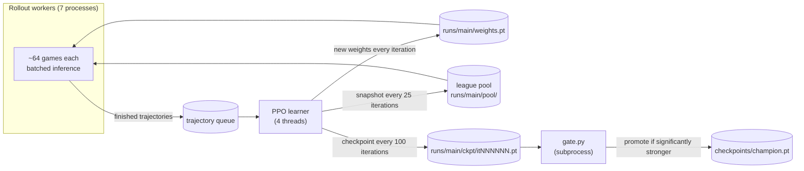

# Training the champion

The champion is a neural network trained from scratch by self-play reinforcement learning (PPO). A single network plays every player count from 2 to 6. Everything runs on CPU: the current champion was trained on one 16-thread desktop processor without a GPU.

This guide describes the method and how to run, monitor and evaluate training. The development history, with the A/B experiments behind each design decision and the throughput measurements, is kept as a research log in [`durak/rl/README.md`](../durak/rl/README.md).

| File | Role |
|---|---|
| [`durak/rl/encoding.py`](../durak/rl/encoding.py) | observation encoder, suit canonicalisation, `PublicTracker` |
| [`durak/rl/model.py`](../durak/rl/model.py) | residual-MLP actor-critic with value, durak and belief heads; `transfer()` for architecture upgrades |
| [`durak/rl/rollout.py`](../durak/rl/rollout.py) | rollout worker: batched self-play, league opponents, solver-ended games, GAE |
| [`durak/rl/train.py`](../durak/rl/train.py) | asynchronous PPO learner: workers, logging, checkpoints, resume, league statistics, gating |
| [`durak/rl/gate.py`](../durak/rl/gate.py) | evaluation suite and champion promotion; writes `runs/eval_summary.json` |
| [`durak/rl/evaluate.py`](../durak/rl/evaluate.py) | command-line evaluation of checkpoints and agents |
| [`durak/rl/tournament.py`](../durak/rl/tournament.py) | ranks several checkpoints on identical deals |
| [`durak/rl/search.py`](../durak/rl/search.py) | PIMC search used by the champion at play time |
| [`durak/agents/champion.py`](../durak/agents/champion.py) | the deployed agent ([BOTS.md](BOTS.md#champion-and-champion_fast)) |

## Overview



Each **iteration** the learner collects 32,768 decisions from the workers, runs one epoch of PPO on them and publishes the new weights. Workers pick up the new weights as soon as they appear, so the data is at most one or two policy versions old; PPO's importance ratio uses the stored behaviour probabilities, which makes that harmless.

## Observation

The network sees the game only from the acting player's point of view: its own hand, the public table state, publicly known cards and the public move log. Hidden cards are never read. The observation is a vector of **918 floats**.

**Relative seats.** Slot 0 is the acting player and slots 1 to 5 are the opponents clockwise. Unused slots (fewer than six players) are marked absent, which is how one network handles every player count.

**Card planes.** 23 planes of 36 cards each:

| Planes | Content |
|---|---|
| 1 | own hand |
| 1 | own cards that the opponents know about |
| 5 | known cards of each opponent slot |
| 1 | discard |
| 1 | uncovered attack cards (one while defending, possibly several during a throw-in) |
| 1 | covered attack cards |
| 1 | defence cards |
| 1 | unseen cards |
| 1 | the face-up trump card while it is still in the talon |
| 5 | per opponent: `cant_beat`, the beaters of a card they chose to take rather than beat |
| 5 | per opponent: `no_throw`, table-rank cards they declined to throw in while the defender was taking |

The two inferred planes are cleared when that player draws from the talon and are restricted to unseen cards. They are computed by the `PublicTracker`, which replays the public move log using card counts only; a test checks it against the engine at every step for every player count.

**Scalars.** 90 numbers: per seat (present, active, hand size, attacker, defender, co-thrower, number of takes, took last bout, finishing place); the phase; the acting player's role (attacker, co-thrower, defender, bystander); talon size, empty talon, first bout, empty table; bout limit, attack count, remaining capacity, defence count and uncovered count; one-hot player count and active-player count; unseen count, finished count and thrower index; the stall counter; and the number of *unknown* cards in each opponent's hand and in the talon.

**Suit canonicalisation.** The trump suit is always mapped to canonical suit 0, and the three other suits are sorted by a key built from all card planes restricted to that suit. Two positions that differ only by relabelling suits therefore give the same observation, and the network never has to learn the same thing four times. The legal-move mask is remapped the same way, and the chosen canonical action is mapped back to a real card. Tests check the invariance and the round trip.

## Model

A residual MLP actor-critic, about **1.42 million parameters**:

```text
obs (918) → Linear 384 → ReLU → 3 × [LayerNorm → Linear → ReLU → Linear, + residual] → LayerNorm → heads
```

| Head | Output | Training signal |
|---|---|---|
| policy | 37 logits, illegal actions masked to −10⁹ | PPO clipped objective |
| value | expected result of the acting seat | squared error against the GAE return |
| durak | logit of "this seat ends as the durak" | binary cross-entropy (weight 0.25); gives calibrated win chances for the web app |
| belief | for each of the 36 cards, logits over 6 locations (opponent slots 1–5 and the talon) | cross-entropy against where each unseen card really was (weight 0.5) |

**Belief head.** Self-play provides free supervision: at every recorded decision the true location of every card unseen by the acting player is known. Locations that cannot hold an unknown card are masked out. The head's detached probabilities are also projected back into the trunk (`bel_proj`, zero-initialised) before the policy and value heads. At play time the belief drives the search's sampling of hidden cards. Training logs `bel_loss`, `bel_acc` and `bel_gain`; the last is the improvement in nats per card over the count-proportional prior that a uniform determinization assumes.

**Compatibility.** Older checkpoints (911 inputs, no belief head) still load: the observation prefix is sliced to the model's input size. `transfer()` copies weights into a larger architecture by zero-padding the input layer and keeping the identity initialisation of new modules, so an upgraded network initially computes exactly the same function; a test checks this.

## PPO

| Setting | Value | Flag |
|---|---|---|
| Decisions per iteration | 32,768 | `--batch-steps` |
| Epochs, minibatch | 1 epoch of 8 minibatches of 4,096 | `--epochs`, `--minibatch` |
| Learning rate (Adam) | 3·10⁻⁴ decaying linearly to 1·10⁻⁴ over 20,000 iterations | `--lr`, `--lr-final`, `--lr-decay-iters` |
| Clip range | 0.2 | `--clip` |
| Entropy coefficient | 0.01 decaying to 0.003 over 5,000 iterations | `--ent`, `--ent-final`, `--ent-decay-iters` |
| Value / durak / belief coefficients | 0.5 / 0.25 / 0.5 | `--vf-coef`, `--durak-coef`, `--belief-coef` |
| Gradient-norm clip | 0.5 | `--max-grad-norm` |
| KL early stop | at 1.5 × 0.03 | `--target-kl` |
| GAE | γ = 1, λ = 0.95, over each seat's own decisions | `--gae-lambda` |
| Network size | 384 hidden units, 3 residual blocks | `--hidden`, `--blocks` |

- **Reward.** Only the terminal result counts: −1 for the durak, +1/(N−1) for everyone else, 0 for a draw. The value is bootstrapped only when a game hits the 2,000-move safety cap.
- **Forced moves**, where exactly one action is legal (about 35% of all moves), are played without the network and not trained on.
- **One epoch** gives two to three times the trained samples per hour of two epochs and was stronger at equal wall-clock time in an A/B test, so it is the default.

## Self-play and the league

- **Player count**: each game draws N from {2: 30%, 3: 15%, 4: 25%, 5: 20%, 6: 10%}.
- **Opponents**: half the games are pure self-play, with every seat on the latest weights. In the other half, 1 to N−1 random seats go to a single opponent type: a league snapshot (weight 0.5), the `heuristic` bot (0.5) or `random` (0.02). Only the learner's own seats are trained on. Scripted bots receive determinized views, like everywhere else.
- **League (prioritized fictitious self-play).** A snapshot of the network joins `runs/<name>/pool/` every 25 iterations; the pool keeps the newest 20 and thins older ones to every fourth. Workers report the learner's durak count against each member, and the learner aggregates these in `league.json` with a decay of 0.995 per iteration. A member's *hardness* is (durak + 2) / (baseline + 2), where *durak* counts the learner's durak results against it and *baseline* is the count expected at the fair share (the sum of 1/N over those games), so 1.0 means par. Each worker loads 3 snapshots sampled in proportion to hardness² and picks among them the same way, so opponents the learner does badly against are played more often.
- **Solver-ended games.** In 70% of games, once the talon is empty, two players remain and at most 12 cards are in play, the exact solver runs with a 30,000-node budget; if it succeeds the game ends with the exact result. About 61–64% of all games end this way, which gives exact terminal rewards and matches how the champion plays endgames. The other 30% are played out so that the policy still learns endgame play, which the champion needs when the solver proves a position lost.
- **Draws** (the stall rule and simultaneous outs) are about 4–5% of games.

## Champion promotion

Every 100 iterations the trainer saves `runs/<name>/ckpt/itNNNNNN.pt` and starts `python -m durak.rl.gate` on it as a separate process, unless the previous gate is still running. Because each gate is a fresh process, changes to `gate.py` take effect without restarting training. The gate:

1. measures the candidate against `random` and dashboard anchors (frozen early networks);
2. plays a symmetric head-to-head against the current champion;
3. **stage 1**: the candidate *and the champion* play the same fresh deals against the heuristic, the heuristic with perfect endgames, and a population of frozen past networks, and the paired differences are combined into one z-score;
4. **stage 2**: if stage 1 passes (z > 1.28 and a positive head-to-head), the same comparison is repeated on new deals, and the candidate is promoted only if that z exceeds 1.645 and no opponent family is significantly worse.

On promotion `checkpoints/champion.pt` is replaced atomically, `checkpoints/champion.json` and `champion_history.jsonl` are updated, and every running `champion` agent, including the web server's, hot-reloads the new network within 30 seconds. The rationale and the statistics are in [EVALUATION.md](EVALUATION.md#the-gate).

## Running training

[`scripts/train.sh`](../scripts/train.sh) starts the trainer fully detached (it survives logging out), writes its PID to `runs/<name>/train.pid` and appends output to `runs/<name>/train.log`:

```bash
scripts/train.sh                              # start or resume the run "main"
NAME=exp2 WORKERS=8 scripts/train.sh --max-hours 24
NAME=exp2 scripts/train.sh --stop             # SIGTERM: saves state.pt and exits
```

| Variable | Default | Meaning |
|---|---|---|
| `NAME` | `main` | run name; files go to `runs/<NAME>/` |
| `WORKERS` | 7 | rollout processes (`--workers`) |
| `LTHREADS` | 4 | learner PyTorch threads (`--learner-threads`) |

Any extra arguments are passed to `python -m durak.rl.train` (see `--help` for the full list). Useful ones:

| Flag | Use |
|---|---|
| `--init checkpoints/champion.pt` | start a **new** run from existing weights (older architectures are transferred) |
| `--no-gate` | evaluate checkpoints but never touch `checkpoints/champion.pt` |
| `--gate-args "..."` | extra arguments for `gate.py`, for example `--gate-args "--anchors checkpoints/frozen_it200.pt"` |
| `--eval-every`, `--eval-workers`, `--eval-games` | how often and how heavily to evaluate (defaults 100, 2, 600) |
| `--max-iters`, `--max-hours` | stop conditions |
| `--solve-frac`, `--solve-max-cards` | solver-ended games (defaults 0.7 and 12) |
| `--no-belief`, `--no-belief-features` | ablations of the belief head |

**Resuming.** Run `scripts/train.sh` again with the same `NAME`: the trainer reads `runs/<name>/state.pt` (model, optimiser, counters, elapsed time) and continues. State is saved every 25 iterations and on a graceful stop. If the code's architecture differs from the saved one, the weights are transferred into the new architecture and the optimiser restarts.

**Gating and the shipped champion.** The gate always compares candidates with `checkpoints/champion.pt`, which is the trained champion shipped in the repository. A run started from scratch will therefore not replace it until it actually beats it. To keep improving the shipped network, start a new run with `--init checkpoints/champion.pt`; for experiments use `--no-gate`. The frozen networks used by the gate (`checkpoints/frozen_it*.pt`) are local files and not part of the repository; missing ones are skipped. Copy any checkpoint there to use it as a reference, for example `cp runs/main/ckpt/it001500.pt checkpoints/frozen_it1500.pt`.

### Files of a run

| Path | Contents |
|---|---|
| `runs/<name>/config.json` | the arguments of the latest start |
| `runs/<name>/train.csv` | one row per iteration: losses, entropy, KL, explained variance, throughput, staleness, solved and draw fractions, belief metrics, training-time durak rates per player count and opponent type, league statistics |
| `runs/<name>/tb/` | TensorBoard logs of the same metrics, plus `eval/*` |
| `runs/<name>/train.log`, `train.pid` | trainer output and process ID |
| `runs/<name>/state.pt` | resume state |
| `runs/<name>/weights.pt` (+ `.version`) | latest weights, read by the workers |
| `runs/<name>/ckpt/` | `latest.pt` and `itNNNNNN.pt` at every evaluation |
| `runs/<name>/pool/`, `league.json` | league snapshots and PFSP statistics |
| `runs/<name>/eval.jsonl`, `eval.log` | one record per gate, and the gate's output |
| `runs/eval_summary.json` | the champion's current results, read by the web app |
| `checkpoints/champion.pt`, `champion.json`, `champion_history.jsonl`, `champion_stats.json` | the champion, its promotion record, all promotions, and its running gate measurements |

## Monitoring

```bash
scripts/status.sh [name]
```

prints whether the run is alive; the latest iteration, decisions, games, hours and throughput; entropy, KL, clip fraction, explained variance, value loss, learning rate and staleness; the belief head's cross-entropy, gain over the prior and accuracy; training-time durak rates by player count against the heuristic and league snapshots; a regression dashboard of the last gates against every opponent family; the hardest league members; the champion's running estimate; and the current champion.

For curves, use TensorBoard (`.venv/bin/tensorboard --logdir runs/main/tb`) or the web app's **Lab** page (`http://localhost:8000/#/lab`), which reads `train.csv`, `eval.jsonl`, the champion files, `eval_summary.json` and `ladder.json` directly. What to watch:

- **Throughput** (`sps`, trained decisions per second) and **staleness** (`stale`, about 1–1.5 is normal).
- **Entropy** falls quickly and then slowly; **KL** stays well below the early-stop threshold; **explained variance** rises.
- **`bel_gain`** should stay positive: the belief head beats the count prior.
- **Gate decisions** in `eval.log`. Long streaks without promotion are normal late in training: the gate is designed to promote only clear improvements.

## Evaluating checkpoints

```bash
# policy + own-seat solver vs a field of heuristic bots (paired deals, deal-clustered 95% CIs)
.venv/bin/python -m durak.rl.evaluate checkpoints/champion.pt --opps heuristic --games 1200 --endgame me

# both sides play perfect endgames: approximates the solver bot
.venv/bin/python -m durak.rl.evaluate checkpoints/champion.pt --opps heuristic --games 1200 --endgame solve

# network A against network B
.venv/bin/python -m durak.rl.evaluate A.pt --opps nn:B.pt --games 1200 --endgame solve

# the full deployed agent with options, two players only
.venv/bin/python -m durak.rl.evaluate 'agent:champion@checkpoints/champion.pt?belief_dets=1' \
    --opps 'agent:champion@checkpoints/champion.pt?belief_dets=0' --ns 2 --games 600

# rank several checkpoints on identical deals
.venv/bin/python -m durak.rl.tournament --ref checkpoints/champion.pt \
    --cands runs/main/ckpt/it200000.pt runs/main/ckpt/it201000.pt --out runs/tournament/t1.json

# re-measure the current champion and refresh runs/eval_summary.json
.venv/bin/python -m durak.rl.gate checkpoints/champion.pt --run-dir runs/main --summary-only
```

[EVALUATION.md](EVALUATION.md) explains the controller specifications, the endgame modes and how to read the output.

## Compute notes for CPU-only machines

The reference machine is a 16-thread desktop CPU (Intel Core i5-12600K) with 31 GB of RAM and no GPU, shared with other work at a load of 20–40.

- **Throughput.** With the defaults (7 workers, a 4-thread learner, one PPO epoch) the main run sustains about 7,000 trained decisions per second, roughly 25 million per hour. A single rollout worker produces about 2,500 trained decisions per second.
- **The learner is the bottleneck**, and more threads do not help: on the loaded machine, 4 learner threads processed 9,200 samples per second, 8 threads 3,600, and 12 threads with a doubled minibatch 5,100; `torch.compile` was slower. The biggest lever was sample reuse: one PPO epoch instead of two.
- **Memory.** About 300 MB per rollout worker, 400 MB for the learner and 300–500 MB per gate process, so roughly 3–4 GB in total with the defaults. Each process that uses the native solver also reserves about 96 MiB of address space for its transposition table (`DURAK_SOLVER_TT_LOG2` reduces it).
- **Gates** take 8–18 minutes with 2 workers, so with the default `--eval-every 100` a new gate usually starts every second or third checkpoint. Gates run at a lower priority (`nice 5`).
- **Smaller machines.** Scale the workers to the cores you can spare, for example `WORKERS=3 LTHREADS=2 scripts/train.sh --eval-workers 1 --eval-every 300`. Fewer workers mean proportionally fewer decisions per hour, but nothing else changes.
- **The C compiler matters.** Without `gcc` the solver falls back to pure Python, which is 50–100 times slower; solver-ended games then dominate the cost. Install `gcc`, or reduce `--solve-frac`.
- **Shared machines.** Rollout, evaluation and ladder worker processes use one PyTorch thread each; the evaluation tools accept `--workers` to stay within a budget, and `tournament.py` has `--nice`.

## Current results

*As of 2026-10-19.* The main run has completed about 203,000 iterations: roughly 6.8 billion trained decisions from 158 million self-play games in 124 hours of training. The current champion is the network from iteration 197,800, promoted on 2026-10-19.

The champion's durak rate as one seat against a field of opponents (policy plus exact endgame solver, without search; running estimate over 6 gates; lower is better):

| Opponents | 2p | 3p | 4p | 5p | 6p |
|---|---|---|---|---|---|
| *Fair share (1/N)* | *.500* | *.333* | *.250* | *.200* | *.167* |
| `heuristic` (9,600 games per cell) | .151 | .098 | .085 | .072 | .061 |
| `heuristic` with perfect endgames (9,600) | .239 | .145 | .129 | .108 | .084 |
| frozen network, iteration 1,500 (2,400) | .339 | .224 | .180 | .145 | .125 |
| frozen network, iteration 50,000 (2,400) | .430 | .288 | .209 | .177 | .145 |
| frozen network, iteration 100,000 (2,400) | .450 | .300 | .232 | .190 | .160 |

Progress against the heuristic bot, measured the same way (paired deals, policy plus own-seat solver), in two-player games:

| Network | Durak rate vs `heuristic` (2p) | vs perfect-endgame heuristic (2p) |
|---|---|---|
| iteration 300 (first round) | .288 | .387 |
| iteration 1,500 (about 4 hours) | .222 | .322 |
| iteration 197,800 (current champion) | .151 | .239 |

**Plateau.** A tournament on 2026-10-19 (4,800 paired games per player count against the heuristic and solver families, 1,200 against each of four frozen networks, plus a symmetric round-robin) found no network newer than the champion that is significantly better, while iteration 150,000 is significantly worse. Against fixed opponents the network has plateaued since about iteration 190,000; the details are in [`durak/rl/README.md`](../durak/rl/README.md#champion-tournament-2026-10-19-runstournament).

The full deployed agent adds search on top: at iteration 1,500 it had a two-player durak rate of .292 against the real `solver` bot (600 paired games), where the network alone scored .322 against the perfect-endgame heuristic. The belief head itself predicts the location of an unseen card correctly 56% of the time, a gain of about 0.10 nats per card over the count-based prior.

Earlier results, the A/B experiments (belief head, belief-weighted sampling, multiplayer search, search budgets, PPO epochs) and ideas that were considered but not built (exploiter agents, expert iteration, ISMCTS) are documented in [`durak/rl/README.md`](../durak/rl/README.md).
