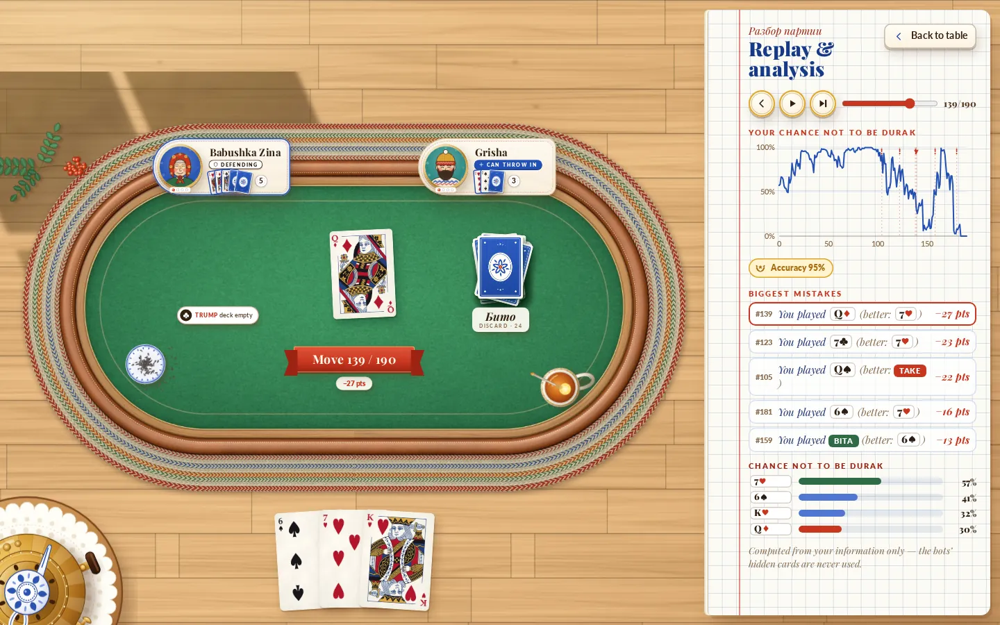
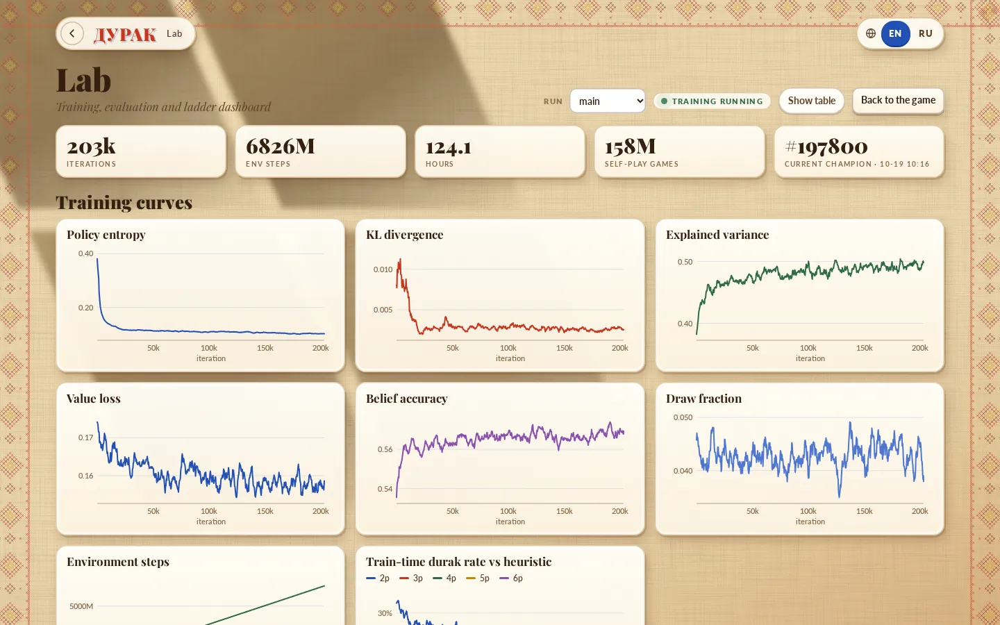

# The web app

The web app lets people play DurakBot's bots in a browser. It has two parts: a FastAPI server ([`server/`](../server)) that owns the games and runs the bots, and a React client ([`web/`](../web)) in an illustrated "Dacha" style, a sunlit Russian country-house table drawn in 2D with DOM, SVG and CSS. A static, server-free build for GitHub Pages is in progress; see [STATIC_BUILD.md](STATIC_BUILD.md).

| Replay and analysis | Lab dashboard |
|---|---|
|  |  |

## Features

**Title screen.** The cast of opponents "at the table today", a one-click **Play** (a new game with your last lobby settings; by default two players against the Grandmaster tier), **Continue game** for an unfinished game after a page reload, and buttons for choosing opponents, watching bots, statistics, the rules and the Lab. A record strip shows your games, escapes, durak count and best streak, and a line states the champion's measured strength when `runs/eval_summary.json` is available.

**Lobby.** Choose 2 to 6 players and your seat, then one of four difficulty tiers (Novice, Intermediate, Expert, Grandmaster), each represented by an illustrated character. Advanced options: watch a bots-only game instead, a fixed deal seed, the debug reveal, and a different bot in each seat.

**At the table.**

- Play a card by dragging it onto the table, by clicking or tapping it, or with the keyboard. Playable cards glow, and a drop slot shows where the card will land.
- One main button changes with the situation: **Bita**, **Pass**, **Take** or **Done** (the [pass action](RULES.md#playing-a-bout) in each phase).
- Every card flies from where it was to where it goes; the speed is adjustable down to *instant*. Bots "think" visibly, and their comments appear as speech bubbles in Russian with an English gloss.
- Seat plaques show each player's role (attacking, defending, can throw in, out), hand size and publicly known cards. The trump card, the talon count and the discard pile are on the table.
- A tea-glass meter shows your current chance of *not* being the durak, estimated by the champion from your own information.
- **Hint** shows the champion's recommended move and the chance not to be the durak after each legal move.
- A game log lists every move in words.
- A short tutorial introduces the controls at your first turn, and the rules are always one click away.
- A button next to your hand switches between sorting by suit and by rank.

**After the game.** A game-over sheet with your result, the seed and the option to play again, then **Replay and analysis**: step through every position as you saw it, with a chart of your chance not to be the durak over the game, the biggest mistakes (moves that lost the most chance compared with the best move), an accuracy score, and the chance after each alternative move. The analysis runs in the background and takes up to two minutes.

**Spectating.** Watch bots play each other with all hands visible: play, pause (Space) and step (→).

**Statistics.** Your results by number of players and by opponent, compared with the fair share, plus how often each bot was the durak and a list of recent games, in which games played with the debug reveal are tagged. The Lab's timeline of your games marks those with hints or the reveal as assisted.

**Settings.** Language (English or Russian), table cloth (green, cobalt or vermilion), card back (Gzhel, Khokhloma or embroidered stitch), a four-colour deck (green clubs, blue diamonds), sound effects, animation speed, whether to show the win chance, and replaying the tutorial.

**Lab** (`#/lab`). A dashboard of the training run: iterations, decisions, hours and games; curves for entropy, KL divergence, explained variance, value loss, belief accuracy, draw fraction and training-time durak rates; the evaluation history against each opponent family with confidence bands and promotion markers; the list of champion promotions; the current evaluation summary; the bot ladder; and your own results over time. Every source is optional, and charts can be switched to tables.

## Running

```bash
scripts/serve.sh                     # build web/ if needed, then serve on 0.0.0.0:8000
HOST=127.0.0.1 PORT=9000 scripts/serve.sh
SKIP_BUILD=1 scripts/serve.sh        # never rebuild the front end
```

`scripts/serve.sh` rebuilds the front end when any file under `web/src`, `web/public` or the build configuration is newer than `web/dist/index.html` (running `npm ci` first if `node_modules` is missing), then starts `uvicorn server.app:app`. `UVICORN_ARGS` passes extra options to Uvicorn.

For development, run the API with auto-reload and the Vite dev server, which proxies `/api` to port 8000:

```bash
.venv/bin/python -m uvicorn server.app:app --reload --port 8000
cd web && npm install && npm run dev  # http://localhost:5173
```

| Environment variable | Default | Effect |
|---|---|---|
| `DURAK_DIST` | `web/dist` | directory of the built front end |
| `DURAK_DB` | `server/data/games.db` | SQLite database of finished games |
| `DURAK_RUNS` | `runs` | where the Lab looks for training and evaluation files |
| `DURAK_CHECKPOINTS` | `checkpoints` | where the Lab looks for the champion files |
| `DURAK_LAB_WARM` | `1` | parse the (large) training log in the background at start-up |

## Server

[`server/app.py`](../server/app.py) creates the FastAPI application. It serves the API under `/api`, the built front end at `/`, and the art under `/assets`. Files in `web/public/assets` that were added after the last build are served too.

- **Sessions** ([`server/sessions.py`](../server/sessions.py)). Each game is a `GameSession` in memory: the real `DurakGame`, one agent per bot seat, a persona (name and portrait) per bot, and the move history. Up to 500 sessions are kept; the least recently used are dropped first. Every request that touches a session runs in a worker thread under that session's lock (a request that waits more than 120 s gets `409 game is busy`), so a slow bot never blocks other games.
- **Bots.** Any registered agent can play. The server checks each agent once and lists the ones that cannot be created (for example without a checkpoint) as unavailable. The default bot is the strongest available in the order `champion`, `grandmaster`, `solver`, `expert`, `heuristic`, `intermediate`, `novice`, `random`. A bot that crashes or returns an illegal move is replaced by a random legal move for that turn, and the error is logged.
- **Views.** `GameSession.view()` produces the state for the client, including opponents' hands only in spectator mode or with the debug reveal ([ARCHITECTURE.md](ARCHITECTURE.md#information-hiding-boundaries)).
- **Coach** ([`server/analysis.py`](../server/analysis.py)). Win chances, hints and the post-game analysis use a champion instance (`champion_fast` if available) on determinizations of the human's information: 2 samples for the win chance, 8 per move for a hint, 3 per decision for the analysis, or a single exact sample when the solver applies. Without a working champion, hints fall back to the default bot's move without percentages.
- **Storage** ([`server/storage.py`](../server/storage.py)). Finished games are written to SQLite: date, mode, player count, seats, loser, finishing order, the human's result and place, number of moves, seed, whether the debug reveal was used, the end reason and the number of hints.
- **Lab data** ([`server/lab.py`](../server/lab.py)). Reads `runs/<run>/train.csv` incrementally (only appended bytes are parsed, and at most 600 points per curve are returned), `eval.jsonl`, the champion files, `eval_summary.json` and `ladder.json`, each cached by modification time.

## HTTP API

All endpoints are under `/api` and exchange JSON. Errors are returned as `{"detail": "..."}` with an HTTP status: `400` for an illegal move, `404` for an unknown game or endpoint, `409` when the request does not fit the game's state (not your turn, game over, spectator game, analysis before the end) and `422` for invalid parameters. FastAPI also serves interactive documentation at `/docs`.

| Method and path | Purpose |
|---|---|
| `GET /api/health` | liveness: `{"ok": true, "sessions": 1}` |
| `GET /api/bots` | available bots and their metadata |
| `POST /api/games` | start a game |
| `GET /api/games/{id}` | current state and the last 400 steps |
| `POST /api/games/{id}/action` | play the human's move |
| `POST /api/games/{id}/advance` | play bot moves |
| `POST /api/games/{id}/debug` | turn the debug reveal on or off |
| `GET /api/games/{id}/evaluate` | chance of not being the durak |
| `GET /api/games/{id}/hint` | recommended move and per-move chances |
| `GET /api/games/{id}/analysis` | post-game analysis (starts it, then reports progress) |
| `GET /api/games/{id}/replay` | every position of a finished game |
| `GET /api/stats` | aggregate statistics of finished games |
| `GET /api/lab?run=main` | Lab dashboard data |
| `GET /api/art/hires` | which high-resolution card art exists |

### `GET /api/bots`

```json
{
  "credential": {"opponent": "solver", "num_players": 2, "win_rate": 0.762, "games": 10800},
  "bots": [
    {"name": "champion", "label": "Champion", "labels": {"en": "Champion", "ru": "Чемпион"},
     "desc": {"en": "Trained RL network with search and an exact endgame solver.", "ru": "..."},
     "tier": 5, "elo": 840, "available": true, "error": null}
  ],
  "unavailable": [],
  "default": "champion",
  "evaluate_available": true,
  "min_players": 2,
  "max_players": 6
}
```

`tier` (0–5) drives the star rating; `elo` is the bot's ladder rating averaged over player counts (or `null`); `credential` is the champion's two-player result from `runs/eval_summary.json` (or `null`). Labels and descriptions come from [`server/bots_meta.py`](../server/bots_meta.py).

### `POST /api/games`

| Field | Type | Default | Meaning |
|---|---|---|---|
| `num_players` | int, 2–6 | 2 | |
| `human_seat` | int or null | 0 | the human's seat; `null` for a bots-only game |
| `spectate` | bool | false | bots-only game with all hands visible |
| `bot` | string | default bot | bot for every bot seat |
| `bots` | list of strings or null | | bot per seat (overrides `bot`; the human's entry is ignored) |
| `seed` | int or null | random | deal seed |
| `debug_reveal` | bool | false | show the bots' hands |
| `auto` | bool | true | play bot moves up to the human's first turn immediately |

The response is `{"game_id", "steps", "state"}`: the new game's ID, the bot steps already played (empty with `auto: false`) and the state.

### Playing moves

`POST /api/games/{id}/action` with `{"action": 0..36, "auto": true}` plays the human's move. With `auto: true` the response also contains every bot reply up to the human's next turn; with `auto: false` it contains only the human's step, and the client pulls bot moves with `advance`.

`POST /api/games/{id}/advance` with `{"max_steps": 1, "until": "step"}` plays bot moves and never plays for the human. `until` is `step` (up to `max_steps` moves, 1–10,000), `bout` (to the end of the current bout) or `end` (to the end of the game, or until it is the human's turn). It returns `409` when the game is over or waiting for the human. If the human has gone out, the rest of the game is played by the bots.

Both return `{"game_id", "steps", "state"}`.

### State

The `state` object (and the `view` inside each step, a compact version without `discard` and `seed`):

| Field | Meaning |
|---|---|
| `game_id`, `mode` | `play` (with a human) or `spectate` |
| `num_players`, `human_seat` | |
| `players` | one entry per seat: `seat`, `name`, `persona`, `bot`, `is_human`, `hand_size`, `known` (publicly known cards), `is_attacker`, `is_defender`, `is_thrower`, `to_move`, `out`, `place`, `is_durak`, and `hand` only for the human or when hands are revealed |
| `hand` | the human's cards |
| `table` | list of `{"attack": card, "defense": card or null}` |
| `trump_card`, `trump_suit`, `talon_size`, `discard_count`, `discard` | |
| `attacker`, `defender`, `throwers`, `thrower_idx`, `phase`, `bout_limit`, `first_bout` | as in the engine; `phase` is `attack`, `defend` or `throw_in` |
| `to_move`, `your_turn`, `legal`, `pass_label` | `legal` and `pass_label` (`bita`, `pass`, `take`, `done`) only on the human's turn |
| `bout`, `moves`, `stall` | finished bouts, moves so far, stall counter |
| `done`, `loser`, `finished`, `result` | `result`: `{loser, draw, reason, finished, human, place}`, where `reason` is `durak`, `draw` or `stalemate` and `human` is `durak`, `safe` or `draw` |
| `debug_reveal`, `seed` | `seed` only once the game is over or hands are revealed |

Cards are integers as described in [ENGINE.md](ENGINE.md#cards); 36 is the pass action.

### Steps and events

Each step describes one move:

```json
{"seq": 0, "player": 2, "action": 0, "card": 0, "kind": "lead", "phase": "attack",
 "events": [], "thrower_slot": 0, "num_throwers": 2, "think_ms": 0, "view": {"...": "..."}}
```

`kind` is `lead`, `throw`, `beat`, `throw_in`, or for a pass `bita`, `pass`, `take` or `done`. `think_ms` is the bot's thinking time. A move that ends a bout carries `events` in order:

| Event | Fields |
|---|---|
| `bita` | `cards`: the discarded table |
| `pickup` | `player`, `cards`: the defender picks up the table |
| `draw` | `player`, `count`; `cards` only for the human's own draws (all draws in spectator mode); `took_trump_card` on the draw that empties the talon |
| `talon_empty` | |
| `out` | `player`, `place` |
| `game_over` | `loser`, `reason` |
| `new_bout` | `attacker`, `defender` |

### Coach endpoints

- `GET /api/games/{id}/evaluate` returns `{"available": true, "values": {"0": 0.5752}}`: the chance that each seat is not the durak. In a game with a human only the human's seat is included; in spectator mode every active seat.
- `GET /api/games/{id}/hint` (only on the human's turn) returns

  ```json
  {"available": true, "has_values": true, "exact": false, "current": 0.5752,
   "recommended": 36, "best": 36,
   "moves": [{"action": 36, "win": 0.6253, "policy": 1.0}, {"action": 24, "win": 0.6048, "policy": 0.0}]}
  ```

  `best` has the highest estimated chance; `recommended` is the network's favourite unless another move is clearly better (more than 3 points) or the position is solved exactly. Each request increments the game's hint count.
- `GET /api/games/{id}/analysis` (after a game with a human) starts the analysis on the first call and returns `{"status": "running", "progress": 0.4}` until it is `ready`, then `timeline` (`[{seq, win}]` for every position), `decisions` (for each of the human's non-forced moves: `chosen`, `best`, `chosen_win`, `best_win`, `loss` and all `values`), `mistakes` (the five largest losses of at least 4 points), `accuracy` (1 minus the mean loss) and `seconds`. The analysis stops after 120 s and marks itself `partial`.
- `GET /api/games/{id}/replay` (after the game) returns `{"game_id", "frames": [{seq, step, view}], "result"}` with one frame per position, as the human saw it.

### `GET /api/stats`

`{"total_games", "human_games", "spectated_games", "human_durak", "human_safe", "streak_best", "streak_current", "human_durak_rate", "by_players": [...], "by_bot": [...], "recent": [...]}`. `by_players` has, per player count, the human's games, durak count and rate, the expected rate 1/N, draws and average place. `by_bot` has, per bot, its seats, durak count and rate against its expected rate, and the human's games and durak rate against it. `recent` lists the last 20 games.

### `GET /api/lab`

`{"run", "runs", "training_active", "train": {"rows", "columns", "series"}, "evals", "promotions", "champion", "eval_summary", "ladder": {"updated", "by_n"}, "human"}`. Any part is `null` when its file is missing. `evals` and `promotions` are condensed gate records (`iter`, `time`, `promoted`, and `rates[opponent][N] = {rate, ci, games}`), and `human` is the timeline of your games.

### `GET /api/art/hires`

`{"cards": [true, true], "cards4": [true, true], "backs": [true, true]}`: whether the @2x and @3x versions of the card faces, the four-colour faces and the card backs exist, so the client only offers files that are really there in `srcset`.

## Front end

The client is React 18 with TypeScript, built by Vite. React is its only runtime dependency when it talks to the server; the in-browser build adds onnxruntime-web.

| Path | Contents |
|---|---|
| `web/src/main.tsx`, `App.tsx` | entry point; the app shell with routing (`#/lab`), screens (title, lobby, game), dialogs, keyboard handling and the move-streaming loop |
| `web/src/api.ts` | typed client for the HTTP API |
| `web/src/dacha/Title.tsx`, `Lobby.tsx`, `Scene.tsx` | title screen, lobby and the background scene |
| `web/src/dacha/table/TableView.tsx`, `CardLayer.tsx`, `layout.ts` | the table: seat plaques, talon, discard, win meter, and the card layer that animates every card between computed poses |
| `web/src/dacha/Sheets.tsx` | settings, statistics, rules, game over, the durak reveal and the tutorial |
| `web/src/dacha/Replay.tsx` | replay and analysis |
| `web/src/dacha/art.ts`, `Brand.tsx`, `Icons.tsx`, `names.ts`, `tiers.ts`, `settings.ts` | art URLs and high-resolution probing, wordmark, icon set, persona names, difficulty tiers, lobby settings |
| `web/src/dacha/ds.css`, `screens.css`, `lobby.css`, `title.css`, `table/table.css` | the design system and screen styles |
| `web/src/lab/Lab.tsx`, `charts.tsx` | the Lab page and its SVG charts (loaded on demand) |
| `web/src/i18n.tsx` | English and Russian strings |
| `web/src/log.ts`, `cards.ts`, `prefs.ts`, `sound.ts`, `fx.ts`, `assets.ts` | move descriptions, card helpers, preferences, synthesised sound effects (Web Audio, no audio files), confetti, asset helpers |

Preferences (`durak.prefs.v2`), lobby settings (`durak.settings`) and the current game ID (`durak.gameId`) are kept in `localStorage`; everything works without it.

The table is laid out in design pixels on a stage that is scaled to the window, with separate layouts for wide screens and phones in portrait. Every card on screen is a keyed target with a pose (position, rotation, width); when the state changes, `layout.ts` computes the new targets and the card layer flies each card from its previous pose. Card faces are served at 1×, 2× and 3× resolution through `srcset`, so they stay sharp on high-density displays, and cards at rest are never scaled or filtered.

## Design system

The "Dacha" look is a warm, illustrated Russian folk-art world: a linen tablecloth in afternoon sun, a samovar and tea, Gzhel and Khokhloma patterns, embroidered borders, a woodcut-style «ДУРАК» wordmark and a cast of illustrated characters. It was chosen from four design concepts kept in [`concepts/`](../concepts) ([ART.md](ART.md#design-concepts)).

- **Light**: the sun comes from the upper left, so shadows fall down and to the right in warm brown; the interface is never dark.
- **Colour tokens** (in `web/src/dacha/ds.css`, mirrored in `web/public/assets/dacha/tokens.css`): linen `#e9d3a8`, paper `#fffaf0`, vermilion `#c8361f`, gold `#e0a52a`, cobalt `#2350b4`, green `#2f6b45` and ink `#33200f`, each with lighter and darker variants.
- **Type**: Playfair Display for display text and Lato for interface text, both with Cyrillic, bundled as WOFF2 files under the SIL Open Font License.
- **Table cloths** green, cobalt and vermilion; **card backs** Gzhel, Khokhloma and embroidered stitch.
- **Cast**: seven bot personas (Babushka Zina, Uncle Misha, Sveta, Kostya, Professor Lev, Dasha, Grisha) plus a monogram for the human. The four difficulty tiers are represented by Kostya, Dasha, Uncle Misha and Professor Lev.

## Accessibility

- **Keyboard play.** Everything at the table works without a mouse:

  | Key | Action |
  |---|---|
  | `1`–`9` | play the n-th legal card in hand order |
  | `←` `→`, `Enter` | select a legal card, play it |
  | `Space` | pass (bita, take or done); skip animations while bots move; pause or resume when spectating |
  | `→` (spectating) | one bot move |
  | `H` | hint |
  | `L` | game log |
  | `S`, `?` | statistics, rules |
  | `N` | new game (lobby) |
  | `M` | sound on or off |
  | `D` | debug reveal |
  | `Esc` | close the open dialog, log or hint; skip animations |

  In the replay, `←` `→` step, `Space` plays or pauses, `Home` and `End` jump, and `Esc` closes. The lobby's player-count, seat and tier choices are exposed as radio groups, and the tier picker works with the arrow keys.
- **Screen readers.** Cards have accessible names (rank and suit), unplayable cards are marked `aria-disabled`, choices use `radio` and `aria-checked`, toggles use `aria-pressed`, charts have text labels, decorative art is hidden from assistive technology, and errors are announced as alerts.
- **Motion.** The `prefers-reduced-motion` setting is respected, and the *instant* speed turns card flights off entirely.
- **Colour.** The four-colour deck distinguishes all suits by colour as well as shape.

## Internationalisation

All interface text is in [`web/src/i18n.tsx`](../web/src/i18n.tsx), with an English and a Russian dictionary of the same keys. The initial language follows the browser's language (Russian if it starts with `ru`, otherwise English) and can be switched at any time. Persona names are localised in the client, and bot labels and descriptions come from the server in both languages. Speech bubbles are always in Russian with an English gloss in the English interface, as part of the setting. Adding a language means adding a dictionary and extending the `Lang` type and the language switch.

## Testing

**Server tests** use FastAPI's test client and need no browser:

| File | Covers |
|---|---|
| [`tests/test_server.py`](../tests/test_server.py) | the bots endpoint and default bot, creating games (bad requests, seat choice, per-seat bots), full games with a random human for every player count, illegal and out-of-turn moves, the debug reveal, spectating, event descriptions, statistics, the hi-res art probe, serving the front end, and that state and history never leak hidden cards |
| [`tests/test_server_coach.py`](../tests/test_server_coach.py) | hints, evaluation and analysis use only the human's information, streaming single steps, replays without leaks, stalemate results, personas, and the Lab with missing and present files |

```bash
.venv/bin/python -m pytest -q tests/test_server.py tests/test_server_coach.py
```

**Browser tests** ([`tests/test_server_e2e.py`](../tests/test_server_e2e.py)) use Playwright with Chromium. They start Uvicorn on a free port with a temporary database, then play complete two- and five-player games on a desktop and a phone viewport, in English and Russian, with real pointer clicks (hit-tested with `elementFromPoint`), the keyboard and drag-and-drop. They check that hidden cards never reach the DOM, exercise the hint, replay and analysis, Lab, tutorial, settings, spectating and the debug reveal, verify that card images get enough pixels for their size on high-density screens, and keep the main JavaScript bundle under 450 kB. Screenshots are saved to `server/data/screenshots/`.

```bash
uv pip install --python .venv/bin/python playwright
.venv/bin/python -m playwright install chromium
(cd web && npm run build)
.venv/bin/python -m pytest -q tests/test_server_e2e.py
DURAK_E2E_DIST=web/dist-next .venv/bin/python -m pytest -q tests/test_server_e2e.py   # test another build
```

The browser tests are skipped automatically when Playwright, Chromium or the built front end is missing. `npm run typecheck` in `web/` checks the TypeScript without building.
